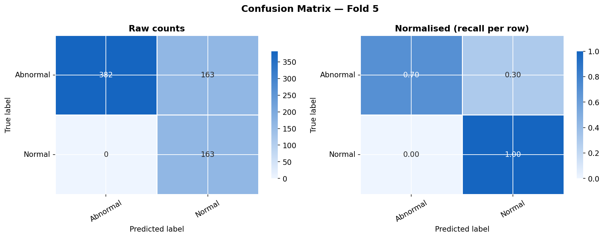
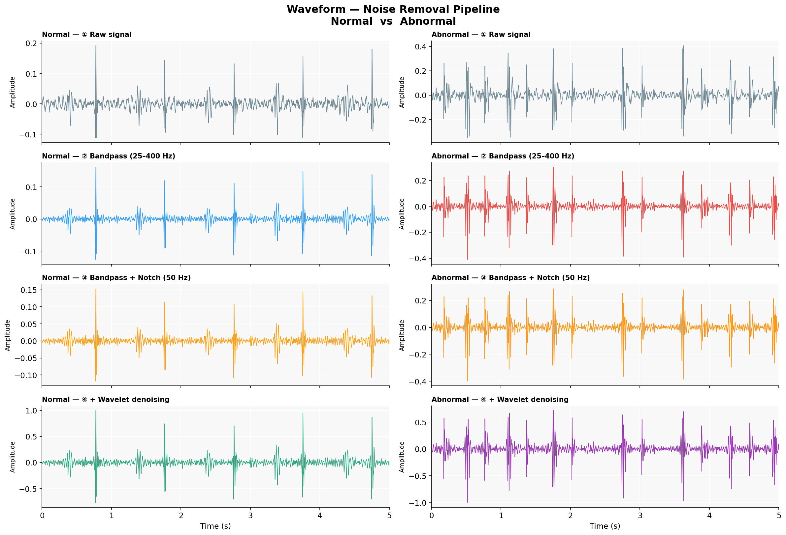

# Deep Learning for Heart Sound Abnormality Detection

Binary classification of phonocardiogram (PCG) recordings as **Normal** or **Abnormal**, using a CNN + bidirectional LSTM with temporal attention. A Simple CNN baseline, trained under the same conditions, measures what the temporal layers add.

Built for the Deep Learning Applications course at Adelaide University by Wimukthi Rajapaksha. This is a research project and is not suitable for clinical use.

## Results

Stratified 5-fold cross-validation on the PhysioNet/CinC Challenge 2016 data (mean ± standard deviation across folds):

| Metric | Simple CNN | CNN + LSTM |
| --- | --- | --- |
| Macro F1 | 0.716 ± 0.017 | **0.732 ± 0.011** |
| Balanced accuracy | 0.817 ± 0.021 | **0.838 ± 0.009** |
| AUC (polarity corrected) | 0.882 ± 0.041 | **0.896 ± 0.028** |
| Best-fold macro F1 | 0.735 | **0.745** |

> [!WARNING]
> These scores are likely optimistic, because the folds contain duplicate recordings. See [Known issues](#known-issues).

The CNN + LSTM scored higher than the baseline on macro F1 in all five folds, though the gain is modest.

CNN + LSTM per-fold results:

| Fold | Macro F1 | Balanced accuracy | AUC (polarity corrected) |
| --- | --- | --- | --- |
| 1 | 0.717 | 0.828 | 0.881 |
| 2 | 0.730 | 0.836 | 0.880 |
| 3 | 0.726 | 0.833 | 0.878 |
| 4 | 0.740 | 0.841 | 0.898 |
| 5 | 0.745 | 0.851 | 0.943 |

The errors are lopsided. In the best fold, every Normal recording was identified, but 30% of Abnormal recordings were also called Normal:

| Class (fold 5) | Precision | Recall | F1 | Support |
| --- | --- | --- | --- | --- |
| Abnormal | 1.00 | 0.70 | 0.82 | 545 |
| Normal | 0.50 | 1.00 | 0.67 | 163 |



Missing an abnormal heart is the costlier mistake in screening, so tuning the decision threshold for higher Abnormal recall is the most obvious next step.

## Pipeline

```text
Raw PCG (.wav)
  │  resample to 2 kHz
  ▼
Denoising        4th-order Butterworth bandpass, 25–400 Hz
                 50 Hz notch filter (Q = 30)
                 Soft-threshold wavelet denoising (db6, level 5)
  │  pad or truncate to 5 s, normalise
  ▼
Log-mel          64 mel bins, 25–400 Hz, n_fft 256, hop 64
  ▼
4 × residual ConvBlock   channels 32, 64, 128, 256
  ▼
Frequency collapse       adaptive average pooling
  ▼
2-layer BiLSTM           256 hidden units per direction
  ▼
Temporal attention       LayerNorm, dropout 0.4
  ▼
Linear classifier        Normal / Abnormal
```

The Simple CNN baseline keeps the same ConvBlocks and replaces the BiLSTM and attention with global average pooling.



### Handling class imbalance

Abnormal recordings outnumber Normal ones about 3.3 to 1. Three techniques are combined:

- **Focal loss** with γ = 3.0
- **Inverse-frequency class weights**
- **Weighted random sampling**, which gives roughly balanced batches

Early stopping monitors validation macro F1 rather than loss, because loss can keep falling while the model collapses onto the majority class.

### Training setup

| Setting | Value |
| --- | --- |
| Optimiser | AdamW, learning rate 3e-4, weight decay 1e-4 |
| Scheduler | Cosine annealing, minimum learning rate 1e-6 |
| Batch size | 32 |
| Epochs | Up to 80, early stopping patience 15 |
| Waveform augmentation | One of: none, Gaussian noise, time shift (±0.25 s), time stretch (0.9–1.1×) |
| Spectrogram augmentation | SpecAugment, frequency mask ≤ 10 bins, time mask ≤ 30 frames |
| Seed | 42 |

The reported runs used the Apple Silicon MPS backend. The notebook also selects CUDA or CPU automatically.

## Repository contents

```text
.
├── Heart Sound Abnormally Detection.ipynb   # Full pipeline, with saved outputs
└── outputs_new/
    ├── cv_results_cnn_lstm.csv              # Per-fold metrics (raw AUC)
    ├── cv_results_simple_cnn.csv
    ├── 01–04, 09, 10, NR_*.png              # Signal and dataset figures
    ├── 05_*, 06_*, 07_*, 11_*.png           # Per-fold training, evaluation, timing
    ├── comparison_cnn_vs_cnnlstm.png
    └── PT_*.png                             # Post-training figures (see Known issues)
```

The dataset and trained weights are not included, so you need to download the data and train the models yourself.

## Running it

1. Install the dependencies. The notebook was last run on Python 3.12, and no package versions are pinned.

   ```bash
   pip install torch librosa PyWavelets soundfile scipy scikit-learn pandas matplotlib seaborn tqdm jupyter
   ```

2. Download the [PhysioNet/CinC Challenge 2016 dataset](https://physionet.org/content/challenge-2016/1.0.0/) and unpack it so each subset folder sits directly inside one directory:

   ```text
   physionet_data_1/
   ├── training-a/   REFERENCE.csv, *.wav
   ├── ...
   └── training-f/
   ```

   The loader reads every subfolder that has a `REFERENCE.csv`, so leave out `validation/` to avoid the duplicates described below. Keep it only if you are reproducing the reported numbers.

3. Set `DATA_DIR` in the `Config` cell to that directory.

4. Open the notebook and run the cells from top to bottom, including the spectrogram cache cell before training. Training the CNN + LSTM took about 30–40 seconds per epoch on MPS.

Checkpoints are saved to `checkpoints/<model_type>/fold<n>_best.pt`. Figures and CSVs go to `outputs_new/`, overwriting the files there.

## Known issues

- **Duplicate recordings across folds.** The 3,541 samples include the 301 recordings in `validation/`, which are byte-identical copies of files in `training-a` to `training-f`. Only 3,240 recordings are unique. Because the folds are split per file, a recording can appear in both training and validation; an estimated 14% of each validation fold has a copy in its training set. This likely inflates the reported scores, which have not been re-measured without the duplicates.
- **Inverted AUC in logs and CSVs.** `evaluate()` scores label 1 (Normal) using the Abnormal probability column, so the logged AUC values, the `cv_results_*.csv` files and the AUC panels in the figures read as 1 − AUC (about 0.10). The tables above show the corrected value, calculated as 1 − raw AUC, not from a new evaluation. Other metrics are unaffected.
- **Post-training figures use older checkpoints.** `get_predictions()` loads `checkpoints/fold<n>_best.pt`, but training saves to `checkpoints/cnn_lstm/fold<n>_best.pt`. The best-fold `PT_*` confusion matrix, ROC, precision-recall, per-class and confidence figures therefore come from an earlier run and don't match the results above. Use the `06_fold*` confusion matrices instead.
- **`predict()` won't run as written.** The single-file inference helper calls `autocast`, which is never defined, and its example call is commented out. Replacing that call with `get_autocast()` should fix it, and the example needs the `checkpoints/cnn_lstm/` path.

## Dataset

Liu C. et al., "An open access database for the evaluation of heart sound algorithms", *Physiological Measurement*, 37(12), 2016. Available from [PhysioNet](https://physionet.org/content/challenge-2016/1.0.0/).
